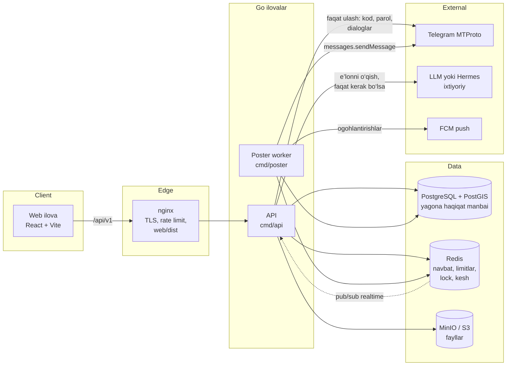
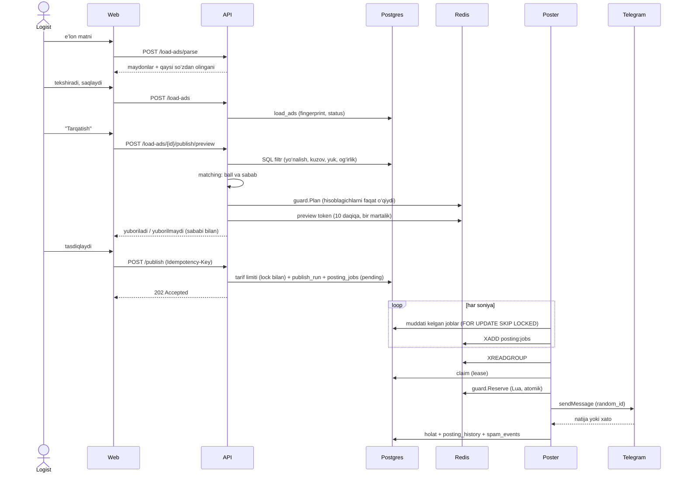

# 1. Arxitektura

## Jarayonlar



| Jarayon | Vazifasi | Nima uchun alohida |
|---|---|---|
| **API** | Auth, e’lonlar, preview va publish, Telegram akkaunt/guruh ulash, dashboard, tarif | HTTP trafik bilan masshtablanadi |
| **Poster** | Postgres’dagi navbatni Redis Streams’ga o‘tkazadi (relay) va Telegram’ga yuboradi (sender) | Telegram sessiyalari faqat shu yerda ochiladi; API deploy qilinsa yuborish uzilmaydi; akkauntlar soni bilan masshtablanadi |
| **PostgreSQL** | E’lonlar, joblar, tarix, akkauntlar, guruhlar, tarif, AI hisobi | Har qanday qaror shu yerga yoziladi, Redis yo‘qolsa ham holat tiklanadi |
| **Redis** | Anti-spam hisoblagichlari (Lua), job navbati (Streams), preview tokeni, lock, kesh, realtime pub/sub | Qisqa umrli arifmetika; Postgres o‘rnini bosmaydi |

## Kod qatlamlari (clean architecture)

```
backend/internal/
  domain/          ← entity, interface (port), biznes qoidalari; tashqi paketsiz
  usecase/         ← stsenariylar: LoadAd, Publish, Telegram, Quota, Dashboard, Alerts
  nlq/             ← e’lon matnini qoidalar bilan o‘qish (tokenizator, joylar, raqamlar)
  ai/              ← model ustidagi "grounded" o‘qish va hisob-kitob (Metered)
  matching/        ← guruhlarni deterministik ballash
  worker/          ← relay va sender (poster jarayoni)
  repository/      ← GORM + raw SQL, har bir so‘rov company_id bilan
  infrastructure/  ← redis, telegram (gotd/td), crypto, queue, ratelimit, storage, push
  delivery/http/   ← handler, route, middleware, dto
  bootstrap/       ← DI: container.go (API), poster.go (worker)
```

Bog‘liqlik yo‘nalishi faqat ichkariga: `delivery → usecase → domain ← repository/infrastructure`.
Usecase’lar interfeyslarni (`domain.PostingGuard`, `domain.TelegramSender`,
`domain.QuotaGuard`…) oladi, shuning uchun har biri soxta (fake) implementatsiya
bilan unit-test qilinadi.

## Asosiy oqim: e’londan postgacha



## Muhim tamoyillar

- **Postgres — haqiqat manbai.** Redis’dagi navbat yo‘qolsa, relay muddati
  kelgan joblarni bazadan qayta chiqaradi. Job holati faqat Postgres’da.
- **Qaror va yuborish ajratilgan.** API hech qachon Telegram’ga post
  yubormaydi: u nimani yuborishni yozadi, poster esa limitlar ichida yuboradi.
- **Idempotentlik uch qatlamda:** publish uchun `Idempotency-Key`; bitta
  e’lon bitta guruh navbatida faqat bir marta (unikal indeks); Telegram
  `random_id` — qayta urinishda xabar ikki marta chiqmaydi.
- **Model ixtiyoriy.** AI bo‘lmasa ham tizim to‘liq ishlaydi
  ([05-hermes-ai.md](05-hermes-ai.md)).
- **Graceful shutdown.** Poster to‘xtatilganda yo‘ldagi yuborish tugaydi va
  yoziladi; tugamagani lease muddati o‘tgach "natija noma’lum" deb belgilanadi
  va avtomatik qayta yuborilmaydi (dublikat spam hisoblanadi).
