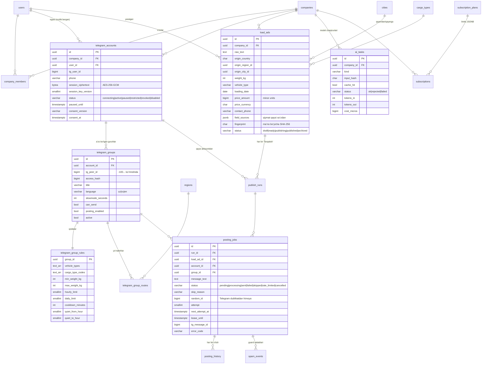

# 2. Ma’lumotlar bazasi (ERD)

PostgreSQL 16 + PostGIS. Migratsiyalar `backend/migrations`, har biri `up`/`down`
jufti bilan; 000002–000014 ortga qaytarilib qayta qo‘llanishi sinalgan.

Tarqatish moduli migratsiyalari:

| Migratsiya | Nima qo‘shadi |
|---|---|
| `000012_telegram_distribution` | Telegram akkauntlar, guruhlar, qoidalar, yo‘nalishlar, e’lonlar, publish run, joblar, tarix, spam hodisalari, AI vazifalar, ruxsatlar |
| `000013_cis_geography` | MDH va qo‘shni davlatlar viloyat/shaharlari (RU, KZ, KG, TJ, TM, AF, TR, CN) |
| `000014_distribution_quotas` | Kompaniya tariflariga tarqatish limitlari |

## ERD

## Muhim qoidalar bazada

- **Tenant izolyatsiyasi kompozit FK bilan.** `telegram_groups`, `publish_runs`,
  `posting_jobs` va boshqalar `(id, company_id)` juftligiga bog‘lanadi: boshqa
  kompaniyaning akkaunti yoki guruhiga job yaratish bazaning o‘zida mumkin emas.
- **Rozilik va sessiya.** `status = 'active'` bo‘lishi uchun
  `session_ciphertext` va `consent_at` majburiy (CHECK). Shifrlangan sessiya
  kalit versiyasisiz saqlanmaydi.
- **Bitta e’lon — bitta guruh navbatida bir marta:** `posting_jobs (load_ad_id, group_id)`
  bo‘yicha `pending/processing/rate_limited` holatlar uchun unikal indeks.
- **`random_id` akkaunt bo‘yicha unikal** — qayta urinish xabarni ikki marta chiqarmaydi.
- **Tarix faqat qo‘shiladi.** `posting_history` har bir holat o‘tishini
  yozadi; Telegram javobi access_hash va telefon raqamlarisiz saqlanadi.
- **Foydalanish yozuvlarning o‘zidan sanaladi.** Alohida hisoblagich jadvali
  yo‘q: e’lonlar, joblar, akkauntlar, guruhlar va `ai_tasks` bo‘yicha oylik
  so‘rov ([06-queue-rate-limits.md](06-queue-rate-limits.md)).
