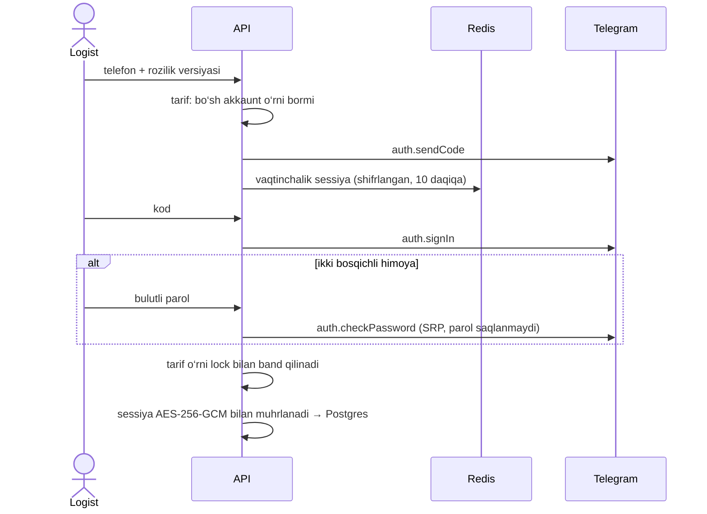

# 4. Telegram integratsiyasi strategiyasi

## Tanlov: har bir logist o‘z akkauntidan (MTProto)

Yuk guruhlari odatda ochiq chat bo‘lib, ularga bot qo‘shilmagan va qo‘shilishi
ham kutilmaydi: odamlar e’lonni odamdan kutadi. Shuning uchun post **logistning
o‘z Telegram akkauntidan** yuboriladi (qaror mahsulot egasi bilan kelishilgan).
Bot API varianti — guruh admini botni qo‘shgan holat — keyinchalik alohida
`TelegramSender` implementatsiyasi sifatida qo‘shilishi mumkin; usecase va
navbat qatlami bunga tayyor.

Kutubxona: `github.com/gotd/td` (MTProto, Go). Kod:
`backend/internal/infrastructure/telegram`.

## Chegaralar — nima qilinmaydi

- Platforma **hech qanday guruhga o‘zi qo‘shilmaydi**; faqat akkaunt allaqachon
  a’zo bo‘lgan va yozish ruxsati bor guruhlar ulanadi.
- **Telegram limitlari aylanib o‘tilmaydi:** `FLOOD_WAIT` hurmat qilinadi,
  pullik "floodskip" hech qachon yoqilmaydi, akkaunt almashtirib limitdan
  qochish yo‘q.
- Shaxsiy xabarlar o‘qilmaydi, update’lar olinmaydi (`NoUpdates`).
- Foydalanuvchi bilmagan holda akkaunt ishlatilmaydi: ulashdan oldin rozilik
  matni ko‘rsatiladi va uning versiyasi (`consent_version`) bilan birga yoziladi.

## Akkauntni ulash

- Noto‘g‘ri kod yoki parol uchun 5 ta urinish; ulash endpointlari har bir
  foydalanuvchi uchun 10 daqiqada 10 so‘rov bilan cheklangan.
- Tarif o‘rni to‘lgan bo‘lsa kod umuman yuborilmaydi. Parallel ulashda oxirgi
  o‘rin boshqasiga ketsa, berilgan sessiya Telegram’da darhol yopiladi.
- Uzish (`DELETE /telegram/accounts/{id}`) Telegram’da `auth.logOut` qiladi —
  qurilma foydalanuvchining "Devices" ro‘yxatidan ham yo‘qoladi — va
  navbatdagi postlarni bekor qiladi.

## Guruhni ulash

Akkauntning dialoglari o‘qiladi; foydalanuvchi ro‘yxatdan tanlaydi.
`can_send` tekshiriladi, sekin rejim (slowmode) soniyalari yoziladi va
cooldown uni hisobga oladi. Peer ID `-100…` ko‘rinishida saqlanadi (JS’da
katta son yo‘qolmasligi uchun API’da string). Yangi guruhga ehtiyotkor
standart qoidalar yoziladi: soatiga 1, kuniga 3 gacha, orasi 60 daqiqa.

## Yuborish va xatolarni tushunish

Har bir yuborish qisqa ulanish: sessiya xotirada ochiladi, `messages.sendMessage`
job’ning o‘z `random_id` si bilan chaqiriladi, so‘ng sessiya baytlari tozalanadi.

| Telegram javobi | Nima qilinadi |
|---|---|
| Muvaffaqiyat | `sent`, `tg_message_id` yoziladi |
| `FLOOD_WAIT_N` | **Butun akkaunt** N soniyaga pauza (Redis + `paused`), job `rate_limited`; 15 daqiqadan uzoq bo‘lsa egasiga, 1 soatdan uzoq bo‘lsa adminlarga ham xabar |
| `SLOWMODE_WAIT_N` | Faqat shu guruh kutadi |
| `PEER_FLOOD`, `USER_RESTRICTED` | Akkaunt `restricted`, navbati bekor qilinadi, egasi + menejerlar + adminlarga xabar |
| `CHAT_WRITE_FORBIDDEN`, `USER_BANNED_IN_CHANNEL` va h.k. | Shu guruhga yuborish o‘chiriladi, xabar beriladi |
| `CHANNEL_PRIVATE`, `USER_NOT_PARTICIPANT` va h.k. | Guruh faolsizlantiriladi, xabar beriladi |
| `AUTH_KEY_UNREGISTERED`, `SESSION_REVOKED` va h.k. | Akkaunt `revoked`, navbati bekor, qayta ulash so‘raladi |
| `RANDOM_ID_DUPLICATE` | Xabar avvalgi urinishda ketgan — `sent` deb yoziladi |
| `MESSAGE_TOO_LONG` | `failed` |
| Tarmoq xatosi | Shu `random_id` bilan qayta urinish: 5 s dan boshlab ikki barobar, 10 daqiqagacha, 5 urinish |
| Noma’lum xato | `failed`, qayta yuborilmaydi, platforma adminlariga xato kodi bilan xabar |

Ishchi jarayon yiqilib, job "yuborilmoqda" holatida qolsa, u avtomatik qayta
yuborilmaydi va "natija noma’lum" bo‘lib tugaydi (`TELEGRAM_TRUST_RANDOM_ID=true`
bilan bu xatti-harakatni `random_id` kafolatiga ishonib o‘zgartirish mumkin).

## Sozlamalar

`TELEGRAM_API_ID`, `TELEGRAM_API_HASH`, `TELEGRAM_SESSION_KEK` — uchalasi birga;
limitlar `TELEGRAM_ACCOUNT_*`, `TELEGRAM_GROUP_*`, `TELEGRAM_GLOBAL_PER_SECOND`
([06-queue-rate-limits.md](06-queue-rate-limits.md)). Barchasi `.env.example` da izohlangan.
