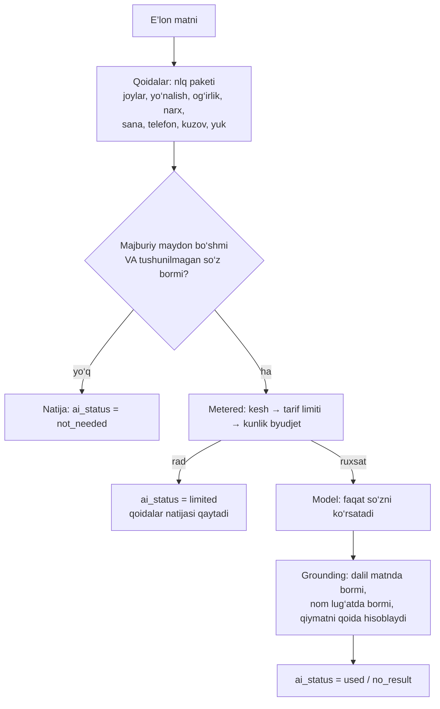

# 5. Hermes / AI integratsiyasi strategiyasi

## Asosiy qoida

Model — **ko‘rsatuvchi, qaror qiluvchi emas.** Biznes mantiqi, ma’lumotlar
bazasi va har qanday hisob-kitob backend’da qoladi. Model yo‘q bo‘lsa ham
tizim to‘liq ishlaydi (`AI_PROVIDER=none`): e’lonlarni qoidalar o‘qiydi,
guruhlarni deterministik ball tanlaydi.

## Qayerda ishlatiladi

Hozircha bitta joyda: **e’lon matnini o‘qish**, va u yerda ham faqat zarur bo‘lsa.
O‘qish natijasi faqat guruhlarni tanlash va takrorni tanish uchun kerak:
guruhlarga logist yozgan matn **o‘zgarishsiz** yuboriladi, model esa hech qachon
matn yozmaydi va uni tahrirlamaydi.



- Model faqat bo‘sh maydonlar va tushunilmagan so‘zlar haqida so‘raladi; unga
  lug‘at, identifikator yoki kompaniya haqida ma’lumot berilmaydi.
- Javob **dalil (evidence)** bilan keladi: matnda aynan bo‘lmagan dalil
  tashlanadi; shahar/viloyat nomi platforma lug‘atida topilishi shart; raqam,
  narx, sana va telefonni model emas, o‘sha qoida qayta hisoblaydi. Model
  qoida topgan qiymatni hech qachon almashtirmaydi.
- Har bir maydon manbasi (`rule`/`ai`) va dalili saqlanadi. Xato o‘qish
  eng yomoni guruh tanlovini buzadi (masalan, e’lon yo‘nalishsiz qolib, faqat
  hamma narsani qabul qiladigan guruhlarga taklif qilinadi), lekin matnga
  ta’sir qilmaydi. Preview har bir guruh sababini ko‘rsatadi va logist
  yubormasdan oldin ro‘yxatni toraytira oladi.
- Yo‘nalish yoki telefon topilmasa, takror tekshiruvi (fingerprint) ma’no
  bo‘yicha emas, normallashtirilgan matn bo‘yicha ishlaydi — o‘qilmagan ikki
  xil e’lon bir-birini "takror" deb to‘smasligi uchun.

## Guruhlarni tanlash (AI cost control)

Spec’dagi "1000 → SQL → 100 → AI → 20" sxemasining birinchi ikki bosqichi
amalda: SQL filtr (yo‘nalish, kuzov, yuk, og‘irlik, faol va yozish mumkin) va
deterministik ball (viloyat yo‘nalishi 40, davlat 25, bir uchi 10, kuzov 15,
yuk 10, og‘irlik 5, katta guruh 5, yaqinda post −15) — har bir ball sababi
bilan. AI bilan qayta tartiblash ixtiyoriy uchinchi bosqich sifatida
qo‘shilishi mumkin; hozir kerak emas, chunki ball tushuntirib bo‘ladigan va bepul.

## Hermes qanday ulanadi

Hermes Agent OpenAI-mos `chat/completions` endpointini beradi, shuning uchun
bitta adapter ikkala provayderni qamraydi:

```env
AI_PROVIDER=hermes          # none | llm | hermes
HERMES_BASE_URL=https://hermes.example/v1
HERMES_API_KEY=...
AI_MODEL=...
```

Hermes’ga beriladigan vazifalar backend’ning aniq, tor interfeyslari orqali
bo‘ladi (`domain.AdExtractor`); Hermes ma’lumotlar bazasiga to‘g‘ridan-to‘g‘ri
kirmaydi va source of truth bo‘lmaydi. Kelajakdagi vazifalar (assistent,
bildirishnoma matni, marshrutlash) ham shu yo‘l bilan: backend so‘raydi, Hermes
taklif qiladi, backend tekshiradi va qaror qiladi.

## Xarajat nazorati

| Mexanizm | Qayerda |
|---|---|
| Kerak bo‘lmasa chaqirilmaydi | `GroundedParser.worthAsking` |
| Kesh (bir xil savol — bepul javob) | Redis, `AI_CACHE_TTL` (standart 24 soat); kalit — prompt, model va matn xeshi |
| Tarif limiti | `ai_requests` oyiga (Start 50, Business 3000, Enterprise cheksiz) |
| Platforma kunlik byudjeti | `AI_DAILY_BUDGET_USD` — yetganda kun oxirigacha hamma uchun to‘xtaydi |
| Hisob | Har bir chaqiruv `ai_tasks` ga: tokenlar, narx (`AI_PRICE_*_PER_MTOK`), kechikish, kesh, rad sababi |

Dashboard’da bugungi va oylik AI so‘rovlari, kesh hitlari va oylik xarajat ko‘rinadi.
