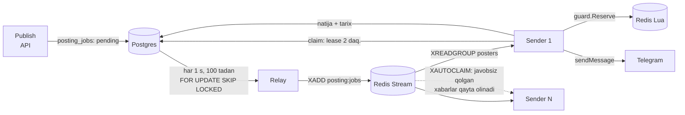
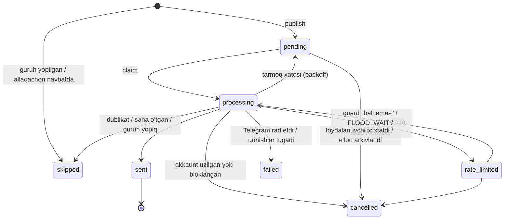

# 6. Navbat va rate-limit arxitekturasi

## Navbat

- **Postgres — rejalashtiruvchi.** `next_attempt_at` qachon urinish kerakligini
  bildiradi; relay muddati kelgan `pending`/`rate_limited` joblarni oladi.
  Redis tozalansa ham hech narsa yo‘qolmaydi — relay ularni qayta chiqaradi.
- **Redis Streams — tarqatuvchi.** Bir nechta poster nusxasi bitta
  consumer group’dan o‘qiydi (`docker compose up --scale poster=N`).
  Xabar bir necha marta kelishi mumkin; kim ishlashini Postgres’dagi
  **claim** hal qiladi (shartli `UPDATE … RETURNING previous_status`).
- **Lease.** Claim job’ni 2 daqiqaga band qiladi. Worker o‘lib qolsa, job
  qayta olinadi, lekin avvalgi holati `processing` bo‘lgani uchun
  "natija noma’lum" deb yopiladi — xabar ikki marta yuborilmaydi.

### Job holatlari

Qayta urinish: `5 s × 2^urinish`, 10 daqiqadan oshmaydi, jami
`TELEGRAM_MAX_ATTEMPTS` (5). Keyingi urinish yuklash sanasidan keyinga
tushsa, post `stale` sababi bilan o‘tkazib yuboriladi — kechagi yukni
oralatib bo‘lsa ham yuborish shovqin.

## Anti-spam guard

Har bir yuborishdan oldin **bitta Redis Lua skripti** hamma shartlarni tekshiradi
va o‘tsa, o‘sha zahoti hisoblagichlarni band qiladi. Tekshiruv va band qilish
bitta atomik operatsiya bo‘lgani uchun ikki worker bir vaqtda o‘ta olmaydi.

| Tekshiruv | Kalit | Standart qiymat | Sozlama |
|---|---|---|---|
| Akkaunt pauzada (FLOOD_WAIT) | `pause:tg:acct:{account}` | Telegram aytgancha | — |
| Dublikat: shu e’lon shu guruhda | `dup:tg:{peer}:{fingerprint}` | 24 soat | `TELEGRAM_DUPLICATE_WINDOW` |
| Guruh uchun oraliq (kompaniya bo‘yicha) | `cd:tg:{company}:{group}` | 1 soat, sekin rejim va guruh qoidasi uzunroq bo‘lsa o‘shancha | `TELEGRAM_GROUP_COOLDOWN` |
| Guruh soatlik / kunlik | `rl:tg:grp:{company}:{group}:{oyna}` | guruh qoidasi; kunlik platforma chegarasi 3 | `TELEGRAM_GROUP_DAILY` |
| Akkaunt: postlar orasidagi minimal oraliq | `gap:tg:acct:{account}` | 90 s | `TELEGRAM_ACCOUNT_GAP` |
| Akkaunt soatlik / kunlik | `rl:tg:acct:{account}:{oyna}` | 20 / 120 | `TELEGRAM_ACCOUNT_HOURLY`, `_DAILY` |
| Global (umumiy api_id’ni himoya qiladi) | `rl:tg:global:{soniya}` | soniyasiga 10 | `TELEGRAM_GLOBAL_PER_SECOND` |
| Jim soatlar | guruh qoidasi | — | — |

- Guruh qoidasi postlarni faqat **kamaytira** oladi, hech qachon platforma
  chegarasidan ko‘paytira olmaydi.
- Preview xuddi shu shartlarni **faqat o‘qib** baholaydi (`Plan`) va har bir
  guruh uchun sababni va "qachon mumkin"ligini ko‘rsatadi.
- Redis mavjud bo‘lmasa guard **yopiq holda** ishdan chiqadi: tekshira
  olmasa, yubormaydi (job 30 s dan keyin qayta urinadi).
- Post yubormaslik bilan tugasa (Telegram rad etdi), band qilingan joy
  qaytariladi; natijasi noaniq (tarmoq xatosi) bo‘lsa — qaytarilmaydi:
  yuborilgan postni hisoblash xavfsizroq xato.

## Tarif limitlari (kvota)

| Metrika | Nima sanaladi | Start | Business | Enterprise |
|---|---|---|---|---|
| `tg_accounts` | ulangan (active/paused/restricted) akkauntlar | 1 | 5 | ∞ |
| `tg_groups` | ulangan guruhlar | 15 | 150 | ∞ |
| `loads` / oy | saqlangan e’lonlar (arxivlangani ham) | 30 | 1000 | ∞ |
| `posts` / oy | navbatda turgan va yuborilgan postlar | 200 | 10 000 | ∞ |
| `ai_requests` / oy | modelga haqiqiy chaqiruvlar (kesh va rad hisobga olinmaydi) | 50 | 3000 | ∞ |

- Foydalanish alohida hisoblagichdan emas, **yozuvlarning o‘zidan** sanaladi:
  bekor qilingan, o‘tkazib yuborilgan yoki xato bo‘lgan post limitni o‘zi
  bo‘shatadi, qo‘lda qaytarish kerak emas.
- Tekshiruv va yaratish kompaniya+metrika bo‘yicha Redis lock ostida — ikki
  parallel so‘rov ikkalasi ham limitdan o‘tib keta olmaydi.
- Oylar platforma vaqt zonasida (Asia/Tashkent) hisoblanadi.
- Limitlar `subscription_plans.limits` JSONB’da; yangi limit qo‘shish kod
  o‘zgartirishni talab qilmaydi. Tarifi yo‘q kompaniya standart (Start) tarifda.
