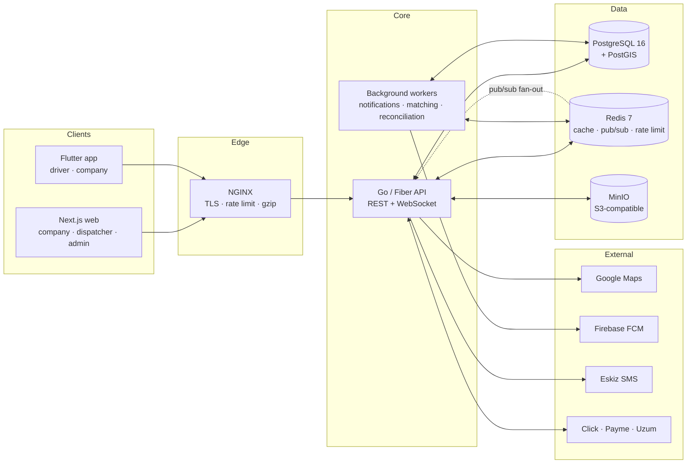
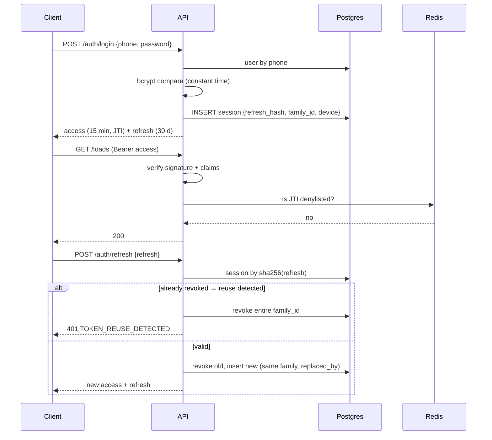
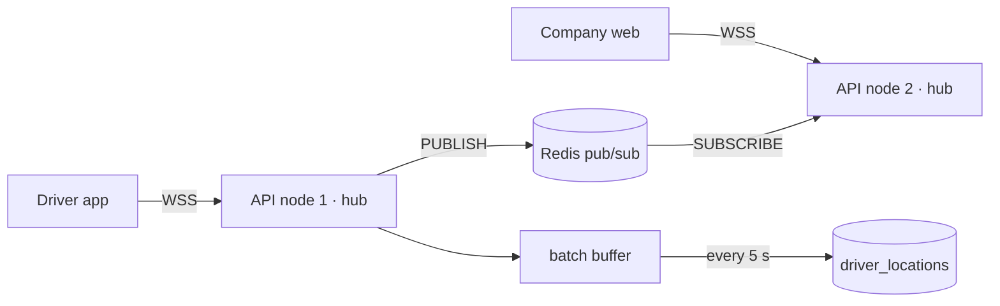

# LOADIFY — Architecture

## System context



---

## Backend — Clean Architecture

Dependencies point **inward only**. `domain` imports nothing from the project.

```
┌──────────────────────────────────────────────────────────┐
│  delivery/http · delivery/ws        (handlers, routes)   │  ← frameworks
├──────────────────────────────────────────────────────────┤
│  usecase                             (business rules)    │  ← orchestration
├──────────────────────────────────────────────────────────┤
│  domain          (entities + repository/service ports)   │  ← pure Go
├──────────────────────────────────────────────────────────┤
│  repository · infrastructure   (GORM, Redis, S3, FCM)    │  ← adapters
└──────────────────────────────────────────────────────────┘
```

- **domain** — entities, enums, domain errors, and *interfaces* (`UserRepository`, `TokenService`, `Storage`, `Notifier`). No GORM tags leak business meaning; persistence concerns stay in adapters.
- **usecase** — one struct per module, receives ports via constructor injection, returns DTOs and `apperror` values. No `fiber.Ctx` and no SQL.
- **repository** — GORM implementations of the domain ports. Transactions are exposed through a `TxManager` port so a usecase can compose multi-repository writes without knowing about `*gorm.DB`.
- **delivery** — Fiber handlers: bind → validate → call usecase → map error → respond. Zero business logic.
- **bootstrap** — the composition root. Constructs every adapter and usecase and wires the routes. This is the only file that knows the whole graph.

### Folder structure

```
backend/
├── cmd/
│   ├── api/main.go              HTTP + WS entrypoint
│   ├── migrate/main.go          up / down / status / force
│   └── seed/main.go             reference data + demo dataset
├── internal/
│   ├── bootstrap/               DI container, route wiring, graceful shutdown
│   ├── config/                  env → typed config, validated at boot
│   ├── domain/                  entities, enums, errors, ports
│   ├── dto/                     request/response contracts per module
│   ├── repository/              GORM adapters + TxManager
│   ├── usecase/                 business rules per module
│   ├── delivery/
│   │   ├── http/handler/        Fiber handlers
│   │   ├── http/middleware/     auth, RBAC, rate limit, request id, recover
│   │   ├── http/route/          route registration per module
│   │   └── ws/                  hub, client, event router
│   └── infrastructure/
│       ├── database/            Postgres connection, health, migration runner
│       ├── cache/               Redis client, pub/sub, distributed lock
│       ├── storage/             MinIO/S3 adapter, presigned URLs
│       ├── sms/                 Eskiz + log providers
│       ├── push/                FCM adapter
│       └── payment/             Click, Payme, Uzum adapters
├── pkg/                         framework-free helpers
│   ├── apperror/ jwt/ hash/ logger/ validator/ pagination/ geo/ response/
├── migrations/                  NNNNNN_name.up.sql / .down.sql
├── docs/                        generated Swagger
└── test/                        integration tests + fixtures
```

### Request lifecycle

```
NGINX → RequestID → Recover → SecurityHeaders → CORS → Logger → RateLimit
      → JWTAuth → RequirePermission → Handler → Validator → UseCase
      → Repository (tx) → Postgres/Redis/S3
      → apperror → ErrorHandler → JSON envelope
```

### Error model

Every failure is an `apperror.Error{Code, Message, HTTPStatus, Details, cause}`.
Handlers never build HTTP status codes by hand — the central Fiber `ErrorHandler` maps
`apperror` to the response envelope and logs the wrapped cause with the request ID.

### Response envelope

```jsonc
// success
{ "success": true, "data": { }, "meta": { "page": 1, "per_page": 20, "total": 134, "total_pages": 7 } }
// failure
{ "success": false, "error": { "code": "VALIDATION_ERROR", "message": "…", "details": [ { "field": "phone", "message": "…" } ] } }
```

---

## Authentication



- Access token: HS256, 15 min, claims `sub`, `jti`, `roles`, `permissions`, `company_id`, `exp`, `iat`, `iss`.
- Refresh token: 256-bit random, stored **hashed** (SHA-256), 30 days, single use, rotation family.
- Logout adds the access `jti` to a Redis denylist with TTL = remaining lifetime, and revokes the session row.
- Blocking a user revokes every session and denylists nothing — the next access-token check reads `status` from the cached user record which is invalidated on block.

## RBAC

Permissions live in the database (`permissions.code` such as `loads.create`, `drivers.verify`).
`RequirePermission("loads.create")` reads the permission set from the JWT claims (refreshed on
every access-token issue) and falls back to a Redis-cached DB lookup when the claim set is stale.
Company-scoped roles carry `company_id`; the middleware injects it into the request context so
repositories can apply tenant filters automatically.

---

## Realtime



- One `Hub` per API node holding `map[userID][]*Client`.
- Cross-node fan-out via Redis channels: `driver:location`, `booking:{id}`, `chat:{room}`, `user:{id}`.
- Location writes are buffered in memory and flushed as a batch insert every 5 seconds — a driver
  reporting at 15s intervals costs one row, not one transaction per point.
- Auth on connect via `?token=` or `Authorization` header; the connection is closed if the token
  expires mid-session and the client must reconnect with a fresh one.
- Heartbeat: server ping every 30s, client must pong within 10s.

---

## Data decisions

| Decision | Rationale |
|---|---|
| UUID v7 primary keys | Globally unique for offline-first mobile, time-sortable so B-tree locality is preserved |
| Money as `BIGINT` minor units | No floating-point drift; UZS has large nominal values |
| PostGIS `geography(Point,4326)` | Correct great-circle distance without hand-rolled haversine SQL |
| `tsvector` + GIN on loads | Full-text search without a separate search cluster at this scale |
| Monthly partitioning on `driver_locations` | The largest table by far; partition pruning keeps the feed fast and drops are cheap |
| Soft delete via `deleted_at` | Legal and dispute requirements; enforced by partial unique indexes |
| Double-entry ledger | Balances are derivable and auditable; single-column balances drift |
| Idempotency keys on payment writes | Providers retry webhooks; replays must be no-ops |

---

## Frontend

```
frontend/src/
├── app/                     Next.js App Router
│   ├── (public)/            landing, load browse, auth
│   ├── (company)/           dashboard, loads, drivers, trips, wallet, analytics
│   ├── (admin)/             admin panel
│   └── api/                 route handlers (BFF: token refresh proxy)
├── components/
│   ├── ui/                  shadcn primitives
│   ├── forms/ maps/ chat/ tables/ layout/ shared/
├── features/                one folder per domain: api hooks, schemas, types, components
├── lib/                     api client, auth, query client, i18n, utils
├── hooks/  stores/  types/  styles/  messages/
```

- **Server state:** TanStack Query only. No duplication of server data into a global store.
- **Client state:** Zustand for auth session, UI preferences, map viewport, WS connection state.
- **Forms:** React Hook Form + Zod. The Zod schema is the single source of truth for both client
  validation and inferred TypeScript types, mirroring the backend validator rules.
- **Auth:** access token in memory + refresh token in an httpOnly cookie set by a Next route handler.
  A single Axios interceptor queues concurrent 401s behind one refresh call.

## Mobile

```
android/lib/
├── core/            config, network (Dio + interceptors), storage, errors, theme, router, di
├── data/            models, datasources (remote/local), repository implementations
├── domain/          entities, repository interfaces, usecases
├── presentation/    features/{auth,home,loads,trips,chat,profile,wallet}/{pages,widgets,providers}
└── shared/          widgets, extensions, utils, l10n
```

Riverpod for state, Dio for HTTP with the same refresh-queue interceptor, Drift/SQLite for the
offline queue, `google_maps_flutter` for maps, `firebase_messaging` for push.

---

## Scaling path

| Stage | Change |
|---|---|
| Launch | One droplet: API + Postgres + Redis + MinIO via Compose |
| 10k users | Managed Postgres with a read replica; API to 2 nodes behind the NGINX upstream |
| 50k users | Separate WebSocket nodes; workers split from the API; Redis for read-through caching of the load feed |
| 200k users | Postgres partitioning already in place for locations; CDC → ClickHouse for analytics; Elasticsearch if `tsvector` stops keeping up |
| Multi-country | `country_id` on every geo entity is already present; add per-region deployments for data residency |
