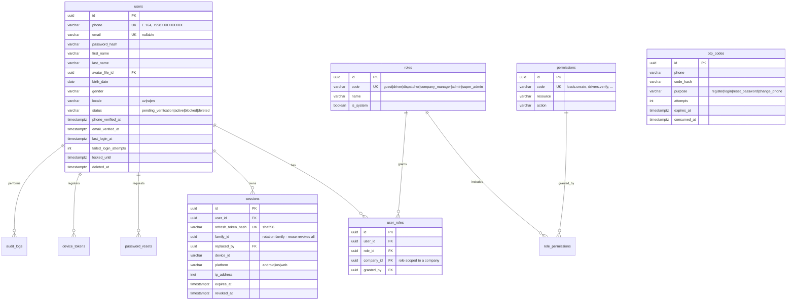
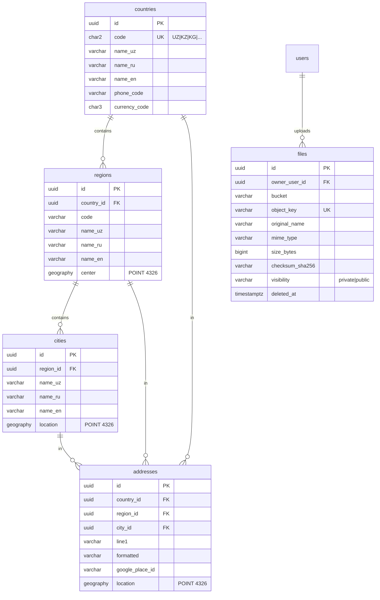
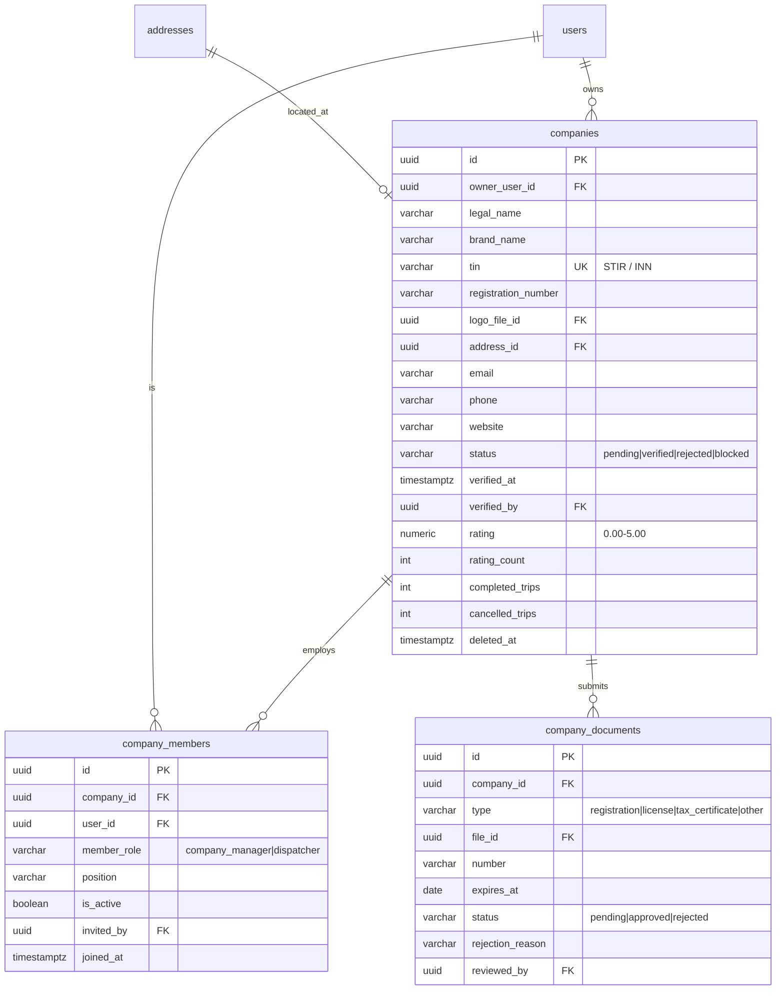
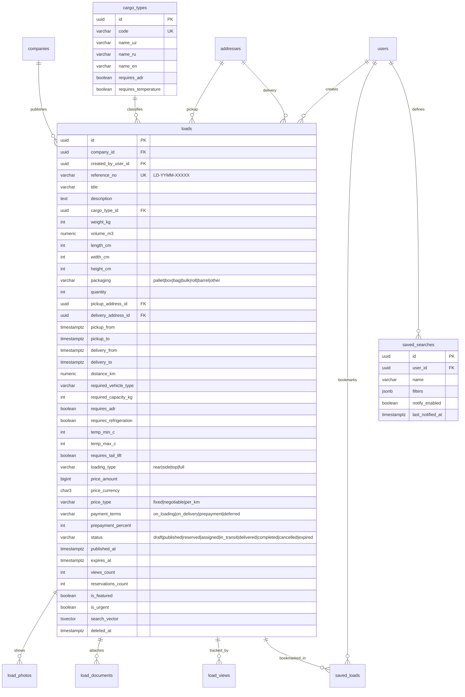
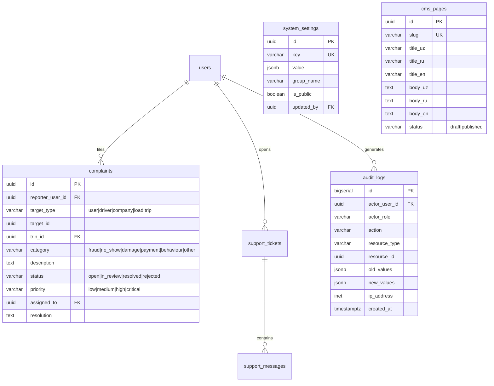

# LOADIFY — Entity Relationship Diagram

The schema is split into 9 bounded contexts. Every table carries `created_at`, `updated_at`
and — where the data must survive deletion — `deleted_at` (soft delete).
Money is stored as `BIGINT` in **minor units** (tiyin for UZS, cents for USD) with an explicit `currency` column.
All timestamps are `TIMESTAMPTZ` in UTC.

---

## 1. Identity & access control



---

## 2. Geography & files



---

## 3. Companies



---

## 4. Drivers & vehicles

```mermaid
erDiagram
    users ||--|| drivers : is
    drivers ||--o{ driver_documents : submits
    drivers ||--o{ vehicles : owns
    vehicles ||--o{ vehicle_photos : has
    vehicles ||--o| trailers : pulls
    drivers ||--o{ driver_availability : publishes
    drivers ||--|| driver_preferences : configures
    drivers ||--o{ driver_locations : reports

    drivers {
        uuid id PK
        uuid user_id FK UK
        varchar license_number
        date license_expires_at
        int experience_years
        uuid home_city_id FK
        text[] languages
        varchar status "offline|online|busy"
        varchar verification_status "pending|verified|rejected"
        timestamptz verified_at
        numeric rating
        int rating_count
        int completed_trips
        int cancelled_trips
        numeric acceptance_rate
        int avg_response_time_sec
        geography current_location "POINT 4326"
        timestamptz location_updated_at
        uuid company_id FK "nullable - employed driver"
        timestamptz deleted_at
    }
    driver_documents {
        uuid id PK
        uuid driver_id FK
        varchar type "driving_license|passport|id_card|insurance|tech_passport|medical"
        varchar side "front|back|single"
        uuid file_id FK
        varchar number
        date issued_at
        date expires_at
        varchar status "pending|approved|rejected"
        varchar rejection_reason
        uuid reviewed_by FK
    }
    vehicles {
        uuid id PK
        uuid driver_id FK
        uuid company_id FK "nullable"
        varchar type "tent|refrigerator|isothermal|flatbed|container|tanker|car_carrier|grain|dump|van|other"
        varchar make
        varchar model
        int year
        varchar plate_number UK
        varchar vin
        int capacity_kg
        numeric volume_m3
        int length_cm
        int width_cm
        int height_cm
        varchar fuel_type "diesel|petrol|gas|methane|propane|electric|hybrid"
        int axles
        boolean has_adr
        boolean has_refrigeration
        int temp_min_c
        int temp_max_c
        boolean has_tail_lift
        date insurance_expires_at
        date tech_inspection_expires_at
        varchar status "pending|approved|rejected|inactive"
        boolean is_primary
        timestamptz deleted_at
    }
    trailers {
        uuid id PK
        uuid vehicle_id FK
        varchar type
        varchar plate_number
        int capacity_kg
        numeric volume_m3
        int axles
    }
    driver_availability {
        uuid id PK
        uuid driver_id FK
        uuid vehicle_id FK
        uuid from_address_id FK
        timestamptz available_from
        timestamptz available_to
        uuid[] preferred_region_ids
        bigint min_price_amount
        char3 currency
        boolean is_active
    }
    driver_locations {
        bigserial id PK
        uuid driver_id FK
        uuid trip_id FK "nullable"
        geography location "POINT 4326"
        numeric speed_kmh
        numeric heading
        numeric accuracy_m
        smallint battery_level
        timestamptz recorded_at
    }
```

`driver_locations` is range-partitioned by `recorded_at` (monthly). Partitions older than 3 months are detached to cold storage.

---

## 5. Loads



---

## 6. Bookings, trips, tracking, ratings

```mermaid
erDiagram
    loads ||--o{ bookings : receives
    drivers ||--o{ bookings : makes
    vehicles ||--o{ bookings : with
    bookings ||--o| trips : becomes
    trips ||--o{ trip_events : logs
    trips ||--o{ trip_documents : carries
    trips ||--o{ driver_locations : traces
    trips ||--o{ ratings : produces

    bookings {
        uuid id PK
        uuid load_id FK
        uuid driver_id FK
        uuid vehicle_id FK
        uuid company_id FK
        varchar initiated_by "driver|company"
        varchar status "pending|offered|accepted|rejected|withdrawn|expired|cancelled"
        bigint offered_price_amount
        bigint agreed_price_amount
        char3 currency
        text message
        timestamptz expires_at
        timestamptz responded_at
        uuid cancelled_by_user_id FK
        varchar cancellation_reason
    }
    trips {
        uuid id PK
        uuid booking_id FK UK
        uuid load_id FK
        uuid driver_id FK
        uuid vehicle_id FK
        uuid company_id FK
        varchar trip_number UK "TR-YYMM-XXXXX"
        varchar status "created|en_route_to_pickup|at_pickup|loaded|in_transit|at_delivery|delivered|completed|cancelled|disputed"
        bigint agreed_price_amount
        bigint commission_amount
        char3 currency
        numeric distance_planned_km
        numeric distance_actual_km
        timestamptz eta_at
        timestamptz started_at
        timestamptz loaded_at
        timestamptz delivered_at
        timestamptz completed_at
    }
    trip_events {
        uuid id PK
        uuid trip_id FK
        varchar type "status_change|location|document|note|delay"
        varchar from_status
        varchar to_status
        geography location
        jsonb payload
        uuid actor_user_id FK
    }
    ratings {
        uuid id PK
        uuid trip_id FK
        uuid rater_user_id FK
        uuid ratee_user_id FK
        varchar ratee_type "driver|company"
        smallint score "1-5"
        text comment
        jsonb criteria "punctuality, communication, cargo_condition"
    }
```

---

## 7. Chat & notifications

```mermaid
erDiagram
    bookings ||--o| chat_rooms : opens
    chat_rooms ||--o{ chat_participants : includes
    chat_rooms ||--o{ chat_messages : holds
    users ||--o{ chat_messages : sends
    users ||--o{ notifications : receives
    users ||--o{ device_tokens : owns
    users ||--o{ notification_preferences : sets

    chat_rooms {
        uuid id PK
        uuid booking_id FK UK
        uuid load_id FK
        varchar status "active|archived"
        timestamptz last_message_at
    }
    chat_participants {
        uuid id PK
        uuid room_id FK
        uuid user_id FK
        uuid last_read_message_id FK
        boolean is_muted
    }
    chat_messages {
        uuid id PK
        uuid room_id FK
        uuid sender_user_id FK
        varchar type "text|image|file|location|system"
        text body
        uuid file_id FK
        geography location
        uuid reply_to_id FK
        timestamptz deleted_at
    }
    notifications {
        uuid id PK
        uuid user_id FK
        varchar type
        varchar title
        text body
        jsonb data
        varchar channel "push|in_app|sms|email"
        timestamptz read_at
        timestamptz sent_at
    }
    device_tokens {
        uuid id PK
        uuid user_id FK
        varchar token UK
        varchar platform "android|ios|web"
        boolean is_active
    }
```

---

## 8. Payments

```mermaid
erDiagram
    subscription_plans ||--o{ subscriptions : sold_as
    users ||--o{ subscriptions : buys
    companies ||--o{ subscriptions : buys
    wallets ||--o{ wallet_transactions : records
    payment_orders ||--o{ payment_webhooks : confirmed_by
    payment_orders ||--o{ refunds : refunded_by
    trips ||--o| escrows : secured_by
    companies ||--o{ invoices : billed

    subscription_plans {
        uuid id PK
        varchar code UK
        varchar target_role "driver|company"
        bigint price_amount
        char3 currency
        varchar period "month|year"
        jsonb features
        jsonb limits
        boolean is_active
    }
    subscriptions {
        uuid id PK
        uuid user_id FK
        uuid company_id FK
        uuid plan_id FK
        varchar status "pending|active|expired|cancelled"
        timestamptz started_at
        timestamptz expires_at
        boolean auto_renew
        uuid payment_order_id FK
    }
    wallets {
        uuid id PK
        varchar owner_type "user|company|platform"
        uuid owner_id
        char3 currency
        bigint balance
        bigint held_balance
        varchar status "active|frozen"
    }
    wallet_transactions {
        uuid id PK
        uuid wallet_id FK
        uuid group_id "double-entry pair"
        varchar direction "debit|credit"
        bigint amount
        bigint balance_after
        varchar category "topup|payout|escrow_hold|escrow_release|commission|subscription|refund|adjustment"
        varchar reference_type
        uuid reference_id
        varchar idempotency_key UK
    }
    payment_orders {
        uuid id PK
        uuid user_id FK
        uuid company_id FK
        varchar provider "click|payme|uzum|stripe|wallet"
        varchar provider_order_id
        varchar purpose "subscription|escrow|topup"
        bigint amount
        char3 currency
        varchar status "pending|paid|failed|cancelled|refunded"
        varchar idempotency_key UK
        jsonb payload
        timestamptz paid_at
    }
    escrows {
        uuid id PK
        uuid trip_id FK UK
        uuid payer_wallet_id FK
        uuid payee_wallet_id FK
        bigint amount
        bigint commission_amount
        varchar status "pending|funded|released|refunded|disputed"
        timestamptz funded_at
        timestamptz released_at
    }
```

---

## 9. Support, admin, CMS



---

## Indexing strategy

| Table | Index | Purpose |
|---|---|---|
| `users` | `UNIQUE (phone) WHERE deleted_at IS NULL` | login lookup |
| `sessions` | `UNIQUE (refresh_token_hash)`, `(user_id, revoked_at)`, `(family_id)` | refresh + rotation family |
| `loads` | `(status, published_at DESC) WHERE deleted_at IS NULL` | main feed |
| `loads` | `GIST (pickup_location)`, `GIST (delivery_location)` | radius search |
| `loads` | `GIN (search_vector)` | full-text |
| `loads` | `(company_id, status, created_at DESC)` | company dashboard |
| `loads` | `(required_vehicle_type, weight_kg, pickup_from)` | filter combination |
| `drivers` | `GIST (current_location) WHERE status = 'online'` | nearby drivers |
| `drivers` | `(verification_status, status)` | admin queue + availability |
| `driver_locations` | `(driver_id, recorded_at DESC)`, `(trip_id, recorded_at)` | trace replay |
| `bookings` | `(load_id, status)`, `(driver_id, status)`, `UNIQUE (load_id, driver_id) WHERE status IN ('pending','offered','accepted')` | one live booking per pair |
| `trips` | `(driver_id, status)`, `(company_id, status)`, `UNIQUE (booking_id)` | trip boards |
| `chat_messages` | `(room_id, created_at DESC)` | message paging |
| `notifications` | `(user_id, read_at, created_at DESC)` | notification centre |
| `wallet_transactions` | `UNIQUE (idempotency_key)`, `(wallet_id, created_at DESC)` | ledger + replay safety |
| `audit_logs` | `(resource_type, resource_id, created_at DESC)`, `(actor_user_id, created_at DESC)` | investigations |
