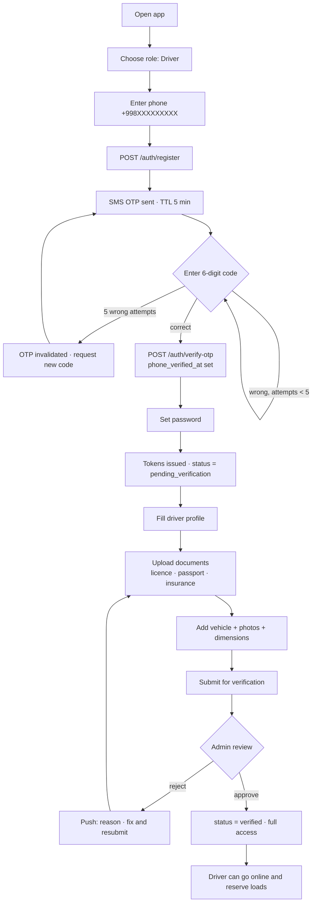
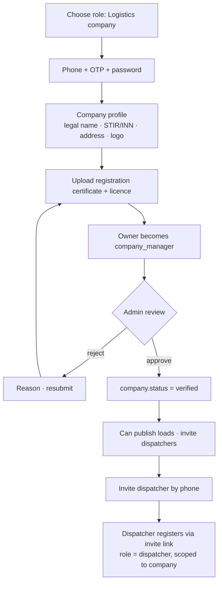
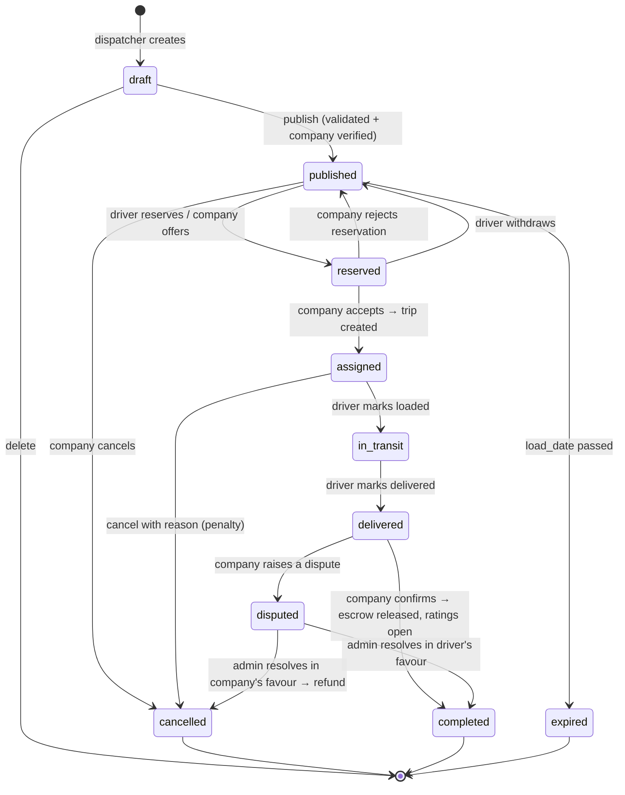
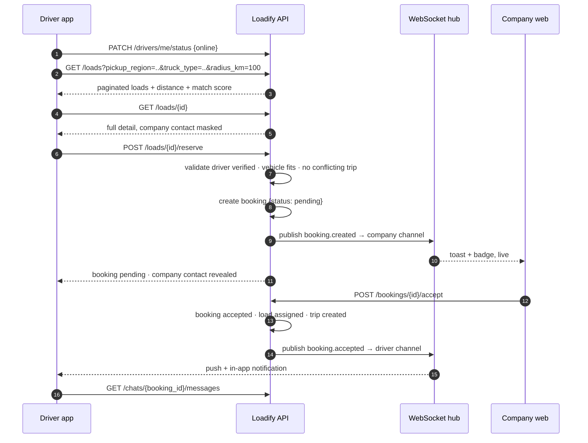
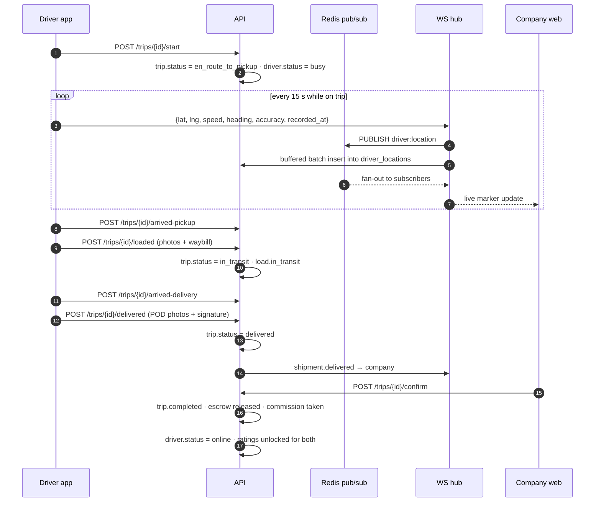
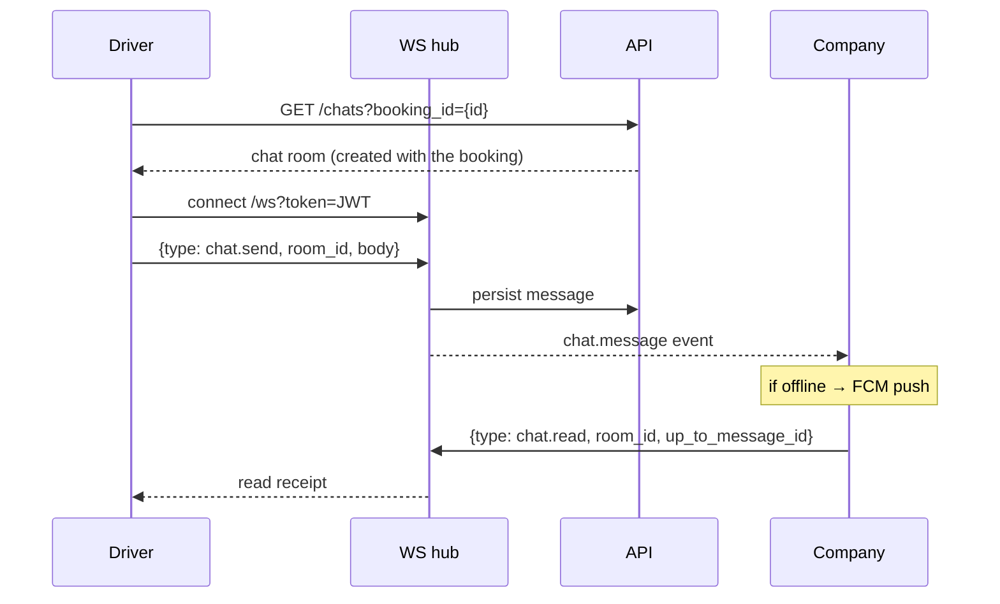
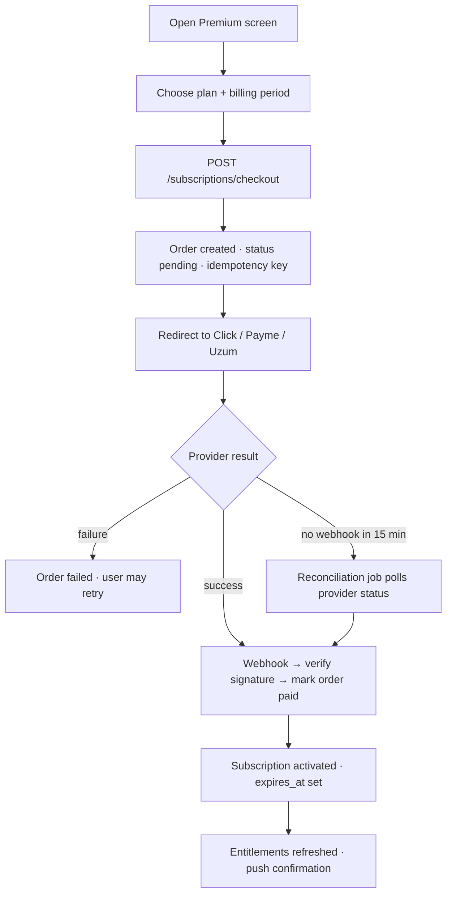
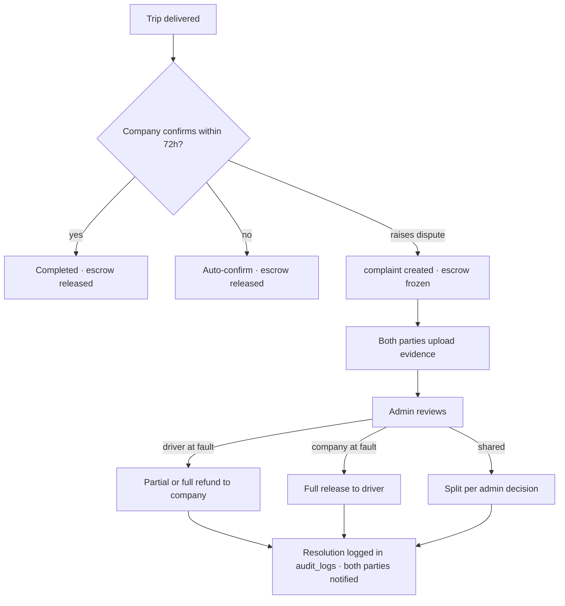
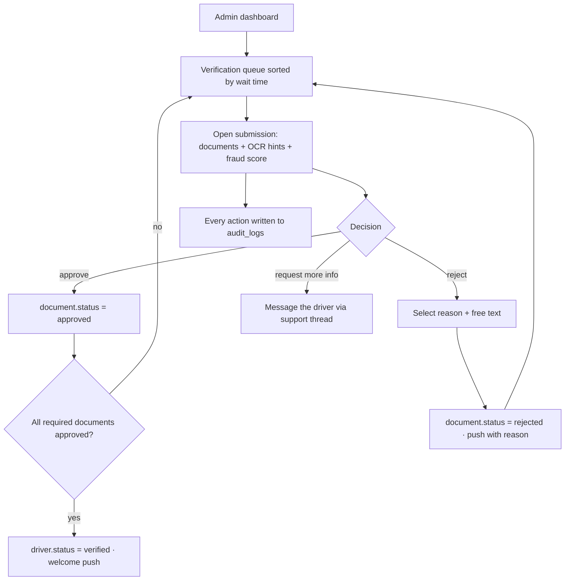
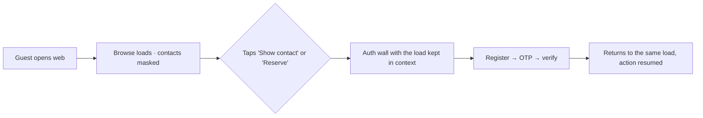

# LOADIFY — User Flows

All diagrams are Mermaid. States in `code` match the enum values in the database.

---

## 1. Driver registration & verification



**Before verification** a driver may browse loads with masked contact details but cannot reserve.

---

## 2. Company registration & verification



---

## 3. Load lifecycle (company side)



---

## 4. Driver finds and reserves a load



Reservation guards, all enforced server-side:
- driver `status = verified` and has at least one approved vehicle
- vehicle capacity ≥ load weight **and** vehicle volume ≥ load volume
- vehicle body type matches `required_truck_type`
- driver has no other trip overlapping the load window
- driver has not exceeded the free contact-reveal quota (unless premium)

---

## 5. Trip execution & live tracking



Offline handling: the Flutter app queues location points in local SQLite and flushes them on reconnect; the server accepts back-dated points and orders by `recorded_at`.

---

## 6. Company books a specific driver

```mermaid
flowchart TD
    A[Company: live driver map] --> B[Filter: truck type · capacity · radius · min rating]
    B --> C[Select driver]
    C --> D[View profile · vehicle · rating · completed trips]
    D --> E[POST /drivers/{id}/offer with load_id + price]
    E --> F[booking {status: offered} · push to driver]
    F --> G{Driver responds within 30 min}
    G -- accept --> H[booking accepted · trip created]
    G -- reject --> I[Company notified · offer another driver]
    G -- timeout --> J[booking expired · auto-suggest next best driver]
```

---

## 7. Chat



Chat rooms exist only for a booking and are archived (read-only) 30 days after trip completion.

---

## 8. Subscription purchase



---

## 9. Dispute



---

## 10. Admin document verification



---

## 11. Guest → registered conversion


